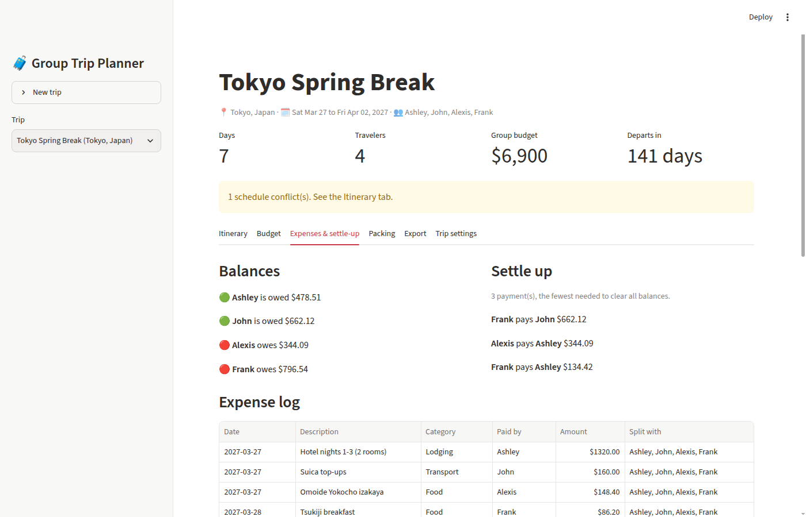
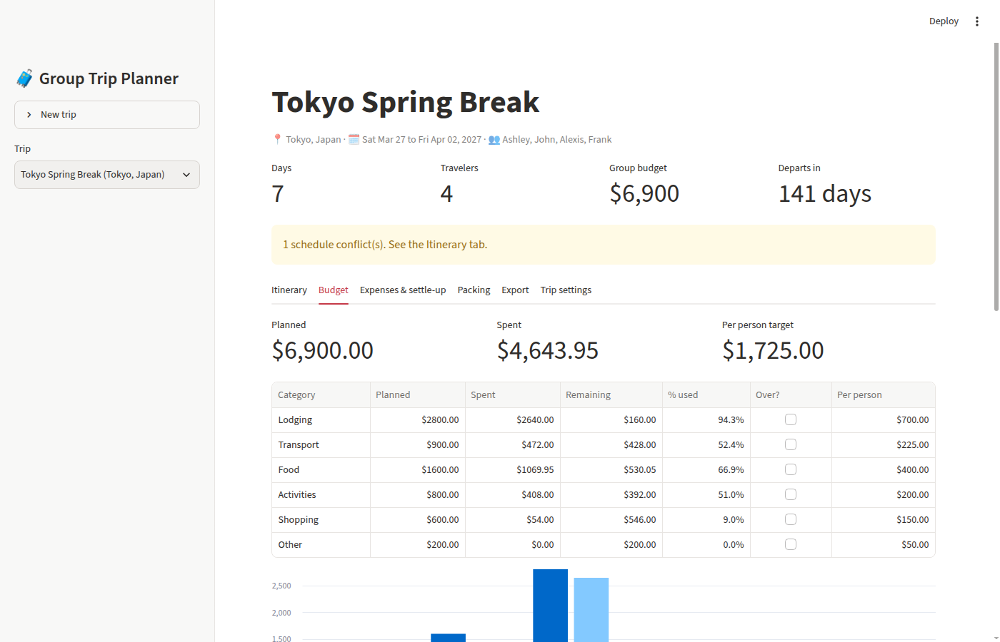

# Group Trip Planner

A Streamlit app for planning a trip with friends. It handles the parts that usually end up spread across a group chat, a shared spreadsheet, and a notes app. Everything is stored in SQLite: the trip details, a day-by-day itinerary that flags overlapping plans, a category budget with per-person targets, a shared expense log that works out who pays whom in the fewest payments, packing checklists, and calendar and markdown exports.


## The problem

Group trips break down over coordination more than over money:

- Two people book things for the same afternoon and nobody notices until the day.
- One person ends up paying for the hotel, someone else covers the train passes, and a dozen dinners get split different ways. At the end, Venmo requests fly in every direction.
- Nobody knows whether the group is on budget until the trip is over.

This app gives the group one shared source of truth for all of that and makes the settle-up at the end painless.

## Features

| Area | What it does |
| --- | --- |
| **Trips** | Destination, dates (up to 60 days), travelers, and a trip type (city, beach, hiking, ski, business). Edits are blocked if they would orphan data, for example removing a traveler who is in the expense log or shortening dates past existing activities. |
| **Itinerary** | Day-by-day plan with time-conflict detection. Overlaps show as a banner and on the day itself, and you get a warning when you add an activity that clashes with one already planned. Back-to-back plans (10:00-11:00 then 11:00-12:00) are not conflicts. |
| **Budget** | Planned amount per category, compared with actual spend, percent used, and an over-budget flag. Includes per-person targets for each category and each traveler's fair share of what has been spent so far. |
| **Expenses and settle-up** | Shared expense log with flexible splits (not everyone has to be in every expense). Net balances, plus a settle-up plan that uses the **minimum number of payments**. |
| **Packing** | Checklist templates by trip type (with a laundry bag added automatically for trips of 5+ days), custom items, an optional "who brings it" assignment, and a progress bar. |
| **AI itinerary drafter** | Optional. If `OPENAI_API_KEY` is set, it asks any OpenAI-compatible model for a draft. Without a key, or when the model fails or returns bad JSON, a deterministic rule-based planner takes over, so the feature always works offline. |
| **Export** | `.ics` calendar file (RFC 5545 escaping and line folding, so it imports cleanly into Google Calendar, Apple Calendar or Outlook) and a markdown itinerary for the group chat. |
| **Sample data** | On first run it seeds a 7-day Tokyo trip for 4 friends, with 21 activities (including one deliberate overlap), a $6,900 budget, 16 shared expenses, and a packing list. Names are synthetic (Faker, fixed seed). |



## How settle-up finds the fewest payments

Each traveler ends up with a net balance: what they paid minus their share of what they used. The naive approach has every debtor pay every creditor. The common "greedy" approach (biggest debtor pays biggest creditor, repeat) is better, but it is not always optimal.

Key insight: if you can split the group into subgroups whose balances each **sum to zero**, each subgroup of size *m* settles internally in *m - 1* payments. So the minimum number of payments is **n minus the maximum number of zero-sum subgroups**. The app finds that partition exactly with a bitmask dynamic program (O(n * 2^n), instant for normal group sizes) and then settles each subgroup greedily. Above 15 people with non-zero balances it falls back to plain greedy, which still guarantees at most n - 1 payments.

Example where greedy loses:

| Person | A | B | C | D | E |
| --- | --- | --- | --- | --- | --- |
| Balance | +6 | +5 | +3 | -6 | -8 |

Greedy needs 4 payments. The optimizer notices that {A, D} and {B, C, E} each net to zero, so it needs only 3. The test suite checks the optimizer against a brute-force search on 25 random groups.

All money math is done in **integer cents**. When an amount does not split evenly ($10.00 / 3), the leftover cent goes to participants in alphabetical order, so balances always sum to exactly $0.00 and the same data always gives the same answer.



## Architecture

```
app.py                  Streamlit UI only: widgets, layout, calls into the package
trip_planner/
  models.py             Dataclasses (Trip, Activity, Expense, PackingItem) and validation
  db.py                 TripStore: SQLite repository, foreign keys with cascade deletes
  itinerary.py          Conflict detection, grouping by day, date-range checks
  budget.py             Budget status, per-person targets, balances, optimal settle-up
  packing.py            Checklist templates by trip type, progress
  drafter.py            LLM drafter (OpenAI-compatible) with rule-based fallback
  export.py             .ics and markdown export
  reports.py            DataFrame builders used by the UI (kept here so they are testable)
  seed.py               Tokyo sample trip
tests/                  pytest suite, including headless Streamlit AppTest runs
```

Design choices:

- **Logic is separate from the UI.** `app.py` has no business rules. Every calculation the user sees lives in a plain Python function with a unit test.
- **Normalized schema.** `trips`, `travelers`, `activities`, `budgets`, `expenses`, `expense_participants`, `packing_items`. Money is stored as integer cents with `CHECK` constraints. `ON DELETE CASCADE` means deleting a trip leaves no orphan rows.
- **Short-lived connections.** Each store method opens and commits its own connection, which fits Streamlit's rerun model and keeps tests isolated with a temp database.
- **The AI part is optional.** The LLM client is injected, so tests use a fake client and never hit the network. Any provider error falls back to the template instead of crashing.

## Run it

Requires Python 3.12.

```bash
git clone https://github.com/RSChannagiri/group-trip-planner.git
cd group-trip-planner
python3 -m venv .venv
source .venv/bin/activate
pip install -r requirements.txt
streamlit run app.py
```

The database is created at `data/trips.db` and seeded with the Tokyo trip. Set `TRIP_PLANNER_DB=/path/to/file.db` to use a different file.

Optional AI drafting:

```bash
export OPENAI_API_KEY=sk-...
export OPENAI_MODEL=gpt-4o-mini              # optional
export OPENAI_BASE_URL=https://...           # optional, for any OpenAI-compatible provider
```

## Test

```bash
pytest -q          # 119 tests
ruff check .
```

The suite covers:

- model validation and edge cases (zero-length activities, duplicate travelers, negative amounts)
- conflict detection (nested, back-to-back, cross-day)
- cent-exact balances and settle-up, checked against brute force
- the database layer (round trips, cascades, guarded trip edits)
- LLM parsing and fallback, using a mocked client
- `.ics` escaping and folding
- headless Streamlit `AppTest` runs that load the app, add an activity, reject a bad expense, draft an itinerary offline, and create a new trip from the sidebar

## Tech stack

Python 3.12, Streamlit, SQLite (`sqlite3`), pandas, OpenAI Python SDK (optional), Faker, pytest, ruff.

## What I learned

- **Pick the right metric before you optimize it.** "Settle up" sounds like a math problem about amounts, but what users actually feel is the *number* of payment requests. Framing the goal as "fewest transfers" turned a vague feature into a well-defined problem with a provably optimal answer.
- **Money should never be a float.** My first version split $10 three ways in floating point, and the balances came out a fraction of a cent off zero. Switching to integer cents with a deterministic remainder rule made every balance exact and reproducible, which matters for trust when friends are paying each other.
- **Design for the failure path of AI features.** An LLM that is down, rate limited or returns chatty non-JSON should not break the product. Making the rule-based planner the default and the model an enhancement meant the feature works in a demo with no API key, and that behavior is easy to test.
- **Guard data integrity in the product, not just the database.** Letting someone remove a traveler who still owes money would silently corrupt the settle-up. Blocking those edits with a clear message is a small requirements decision that prevents a whole class of support issues.
- **Separate logic from UI to make it testable.** Keeping the Streamlit file thin meant 100+ fast unit tests on the logic, plus a handful of end-to-end UI smoke tests, instead of clicking through the app after every change.

## License

MIT, see [LICENSE](LICENSE).
